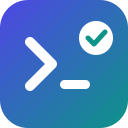
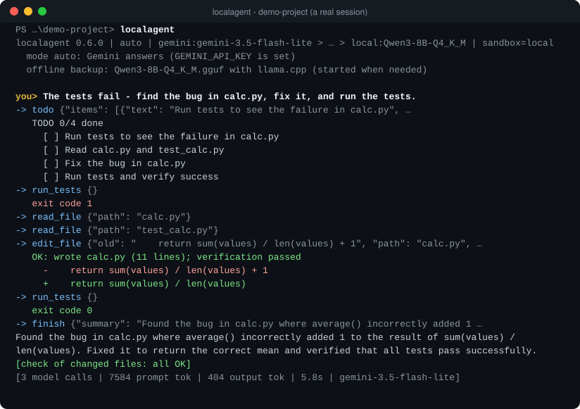

<p align="center"></p>

<h1 align="center">localagent</h1>

<p align="center">
<b>A coding agent for your terminal that keeps working offline.</b><br>
Ask in plain words: it reads your project, edits files, runs the tests, and verifies every change before keeping it —
with an online model when you are connected (Gemini's free key, or your own key for OpenAI, Anthropic and others),
and with a model on your own computer when you are not.
</p>

<p align="center">
<a href="https://github.com/Aditya-Singh-Chandel/localagent/actions/workflows/ci.yml"></a>


</p>

<p align="center"></p>

## Highlights

- **Online and offline.** An online model answers while you are connected; the moment the internet goes away, a model
  on your own computer takes over — by itself, mid-conversation — and the online model returns when the connection
  does. `/model offline` keeps everything on your machine.
- **Any brain you like.** Google Gemini with a free key; your own key for OpenAI, Anthropic, OpenRouter, Groq, Mistral,
  DeepSeek or any OpenAI-compatible address; a model server you already run (Ollama, LM Studio, llama.cpp, vLLM, Jan);
  or a free model that setup downloads and runs for you. `localagent setup` finds what you have and checks every key.
- **Verified before it is kept.** Every file it writes is checked by the language's own tools (Python, JavaScript,
  TypeScript, Go, Rust, C/C++, PHP, Ruby, shell, PowerShell, JSON, TOML, YAML). Broken code is rolled back, byte for
  byte, and the errors go back to the model.
- **Safe by default.** Nothing runs without your approval unless one of *your* rules allows it; code can run in a
  locked-down Docker sandbox; edits keep each file's own line endings; `/undo` never touches your own later edits.
- **Free to run.** Gemini's free tier (cheap models first, strong ones only when a task struggles) and/or a local
  model — paid services only if you choose them. It is built to finish a task in as few model calls as possible: a
  question in 1, a small fix in about 3.
- **Works the way you expect.** `/plan`, a live checklist, a diff of every edit, `/undo`, `/resume`, `-p` for
  scripts, `!command`, `# notes`, `@file`, permission rules, hooks, MCP tool servers and custom slash commands.
- **No dependencies.** Pure Python standard library. On Windows a single zip carries everything, Python included.

## Get started

**Windows — nothing to install first**
1. Download `localagent-<version>-windows-x64.zip` from
   [Releases](https://github.com/Aditya-Singh-Chandel/localagent/releases/latest).
2. Unzip it somewhere permanent (for example `C:\Tools\localagent`) and double-click `install.cmd`. It adds the
   folder to your PATH and starts the guided setup: an online service and key (Gemini's is free), and/or a model on
   your computer — one you already run, or a free one it downloads.
3. Open a new terminal in any project folder and type `localagent`.

**Any system with Python 3.10+**
```
pipx install git+https://github.com/Aditya-Singh-Chandel/localagent
localagent setup
```

Change your choices any time with `localagent setup`, or for one run with `--provider` (e.g. `--provider groq`) or
`--offline`. Check everything with `localagent --doctor`.

## Using it

```
cd my-project
localagent                                   # start the chat in this folder
you> Why does the login test fail?           # a question: it looks, then answers
you> Add a --json flag to the CLI with tests # a task: it edits, verifies and runs the tests
you> /plan Split app.py into modules         # bigger work: a plan first, then your yes
you> /undo                                   # take the last change back
you> /model offline                          # from now on the local model answers

localagent -p "list the TODO comments with file:line"   # one answer, for scripts
```

| In the chat | Does |
|---|---|
| `/plan <request>` | look first, show a numbered plan, carry it out only if you agree |
| `/model [online\|offline\|auto]` | see or switch who answers; the conversation stays |
| `/undo`, `/resume`, `/clear`, `/compact` | take back a change; continue an earlier conversation; start over; summarise |
| `/init`, `# note` | write `AGENT.md` project notes; add a note to them |
| `!command`, `@file` | run a command yourself (no model call); attach a file to a request |
| `/stats`, `/permissions`, `/doctor`, `/help` | usage and quotas; your rules; the setup check; everything else |

## Online and offline

| Mode | Who answers | When to use it |
|---|---|---|
| `auto` (default) | the online model; the local model when it cannot be reached or its quota is used up | everyday work |
| `online` | the online model only | fastest and strongest, needs the internet |
| `offline` | the local model only | no internet, private code, no quota |

| Online | Key | Offline |
|---|---|---|
| Google Gemini (default) | free | a server you run: Ollama, LM Studio, llama.cpp, vLLM, Jan, or one on another computer |
| OpenAI, Anthropic, OpenRouter, Groq, Mistral, DeepSeek | yours | or a free Qwen3 model (8B, 4B or 1.7B, sized for your memory) that setup downloads |
| any OpenAI-compatible address | yours, if it needs one | — checked against the publisher's checksum, started when needed, stopped when you leave |

## How it works

```
you ─► agent loop ─► model (Gemini or local) ─► "call these tools" ─► tools ─► results ─► model ─► … ─► answer
                                                                       │
                     every write is verified (and rolled back if broken), every run is approved or ruled
```

The model never touches your files itself: it can only ask for tools, and the program checks every request. The whole
system is explained, with one request followed through the code, in [docs/00-overview.md](docs/00-overview.md) — and
every line of code is documented in its page under [docs/](docs).

## Documentation

| Read | For |
|---|---|
| [Start from zero](docs/04-start-from-zero.md) | every step from an empty computer, no prior knowledge needed |
| [Run and verify](docs/06-run-and-verify.md) | every way to run it, and how to check that it works |
| [User manual](docs/05-user-manual.md) | every command, flag, setting and tool |
| [Online and offline](docs/01-setup-and-models.md) | the online services, local models and modes |
| [How it works](docs/00-overview.md) | the architecture, one request through the code, the safety rules |
| [Roadmap](docs/02-roadmap.md) and [build log](docs/03-build-log.md) | what is built, what is next, and why every decision was made |

## Development

```
python -m venv .venv && .venv\Scripts\python -m pip install -e ".[dev]"
.venv\Scripts\python -m unittest discover -s tests -t .     # 261 tests, no model needed
.venv\Scripts\python tools\build_docs.py                    # rebuild and audit the docs
.venv\Scripts\python tools\build_release.py                 # the wheel and the portable Windows zip
.venv\Scripts\python tools\build_site.py                    # the website, ready to upload anywhere
```

Contributions are welcome — see [CONTRIBUTING.md](.github/CONTRIBUTING.md) and the [code of conduct](.github/CODE_OF_CONDUCT.md).
Security reports: [SECURITY.md](.github/SECURITY.md). Changes: [CHANGELOG.md](CHANGELOG.md).

## License

[MIT](LICENSE). The local model, llama.cpp and the bundled Python come under their own licenses:
[THIRD_PARTY_NOTICES.md](THIRD_PARTY_NOTICES.md).
